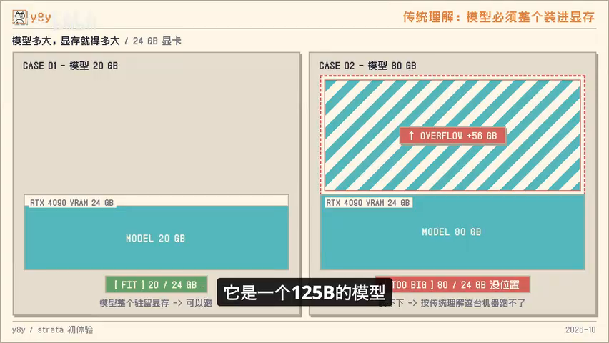
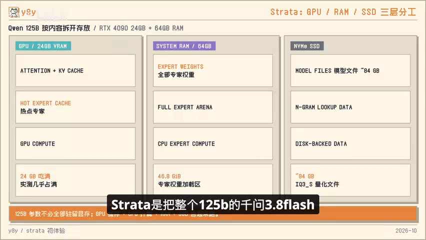
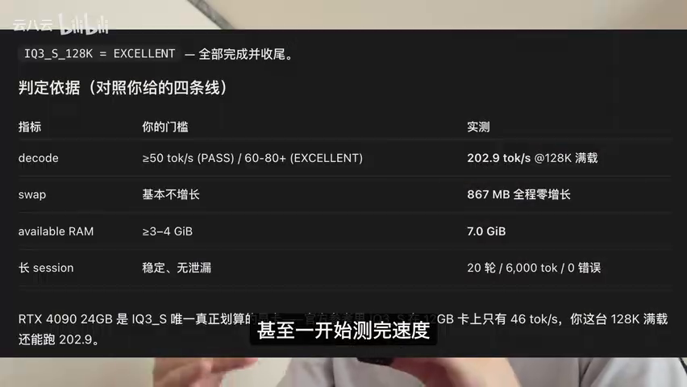
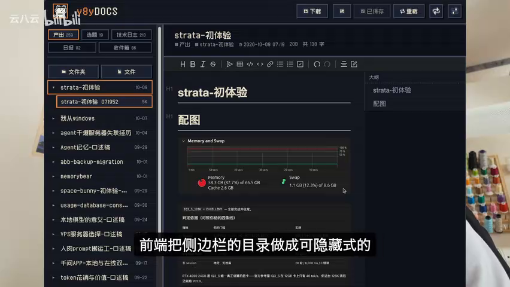
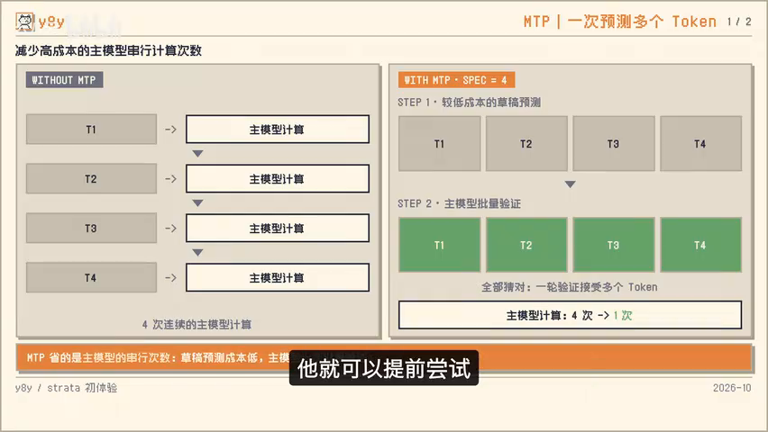
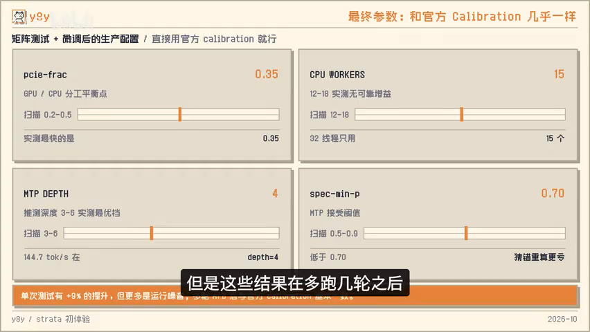
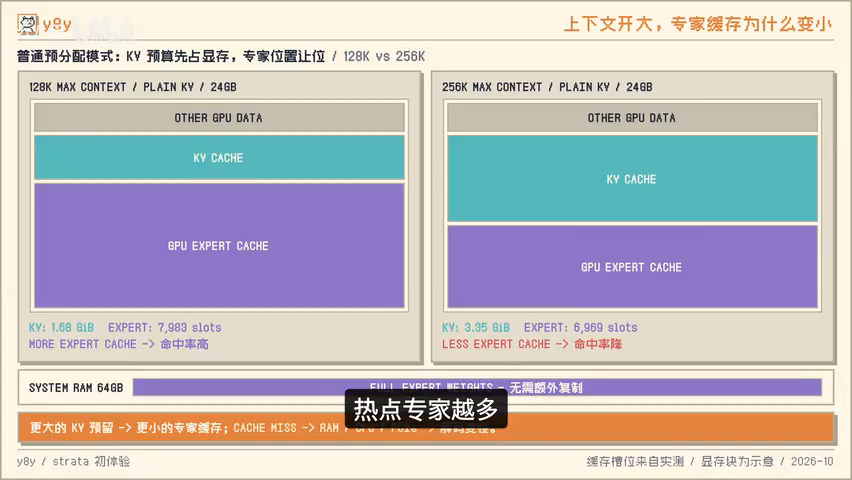
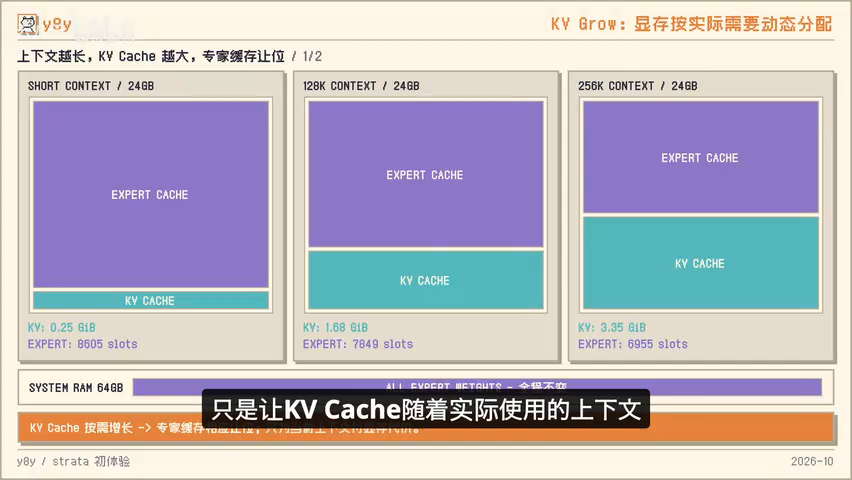

# 关键截图说明

> 所有图片均从用户提供的 852×480 原视频直接抽取为 PNG，未放大或二次压缩。

## 02:28｜模型规模与显存：125B 模型与传统驻留显存方式对比

## 04:19｜Strata 分层架构：GPU、CPU、RAM 与 SSD 协同

## 06:11｜初测 Benchmark：约 203 token/s，后续视频会修正测试方法

## 07:16｜实际任务演示：修改文档编辑系统前端

## 09:14｜MTP 多 token 预测原理

## 10:12｜自动校准与手工矩阵测试结果对比

## 12:41｜KV Cache 与热点专家缓存的关系

## 13:58｜KVGrow：KV Cache 随实际上下文逐步增长

